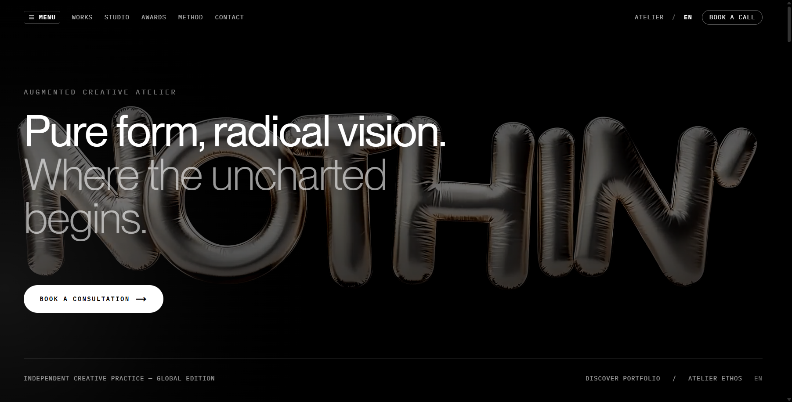
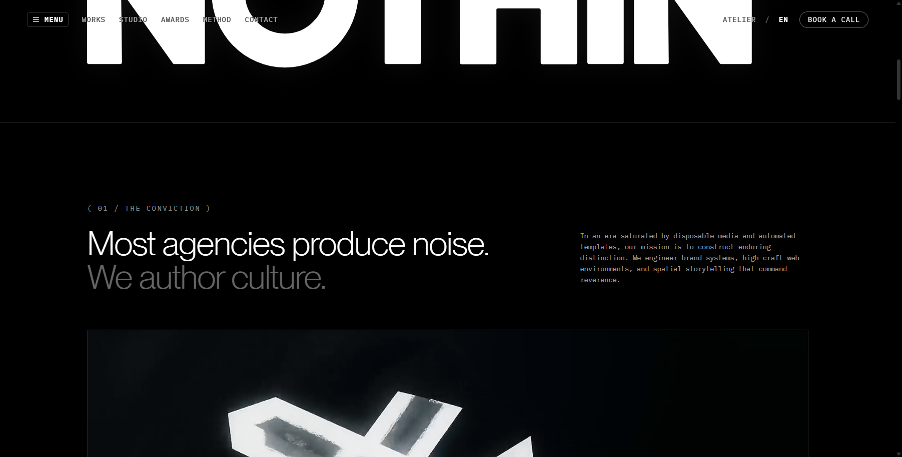
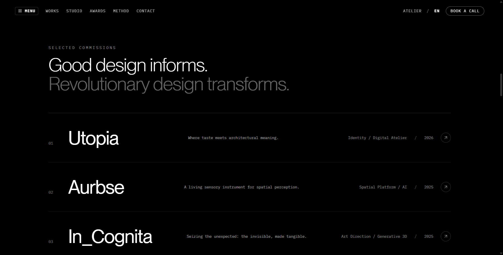
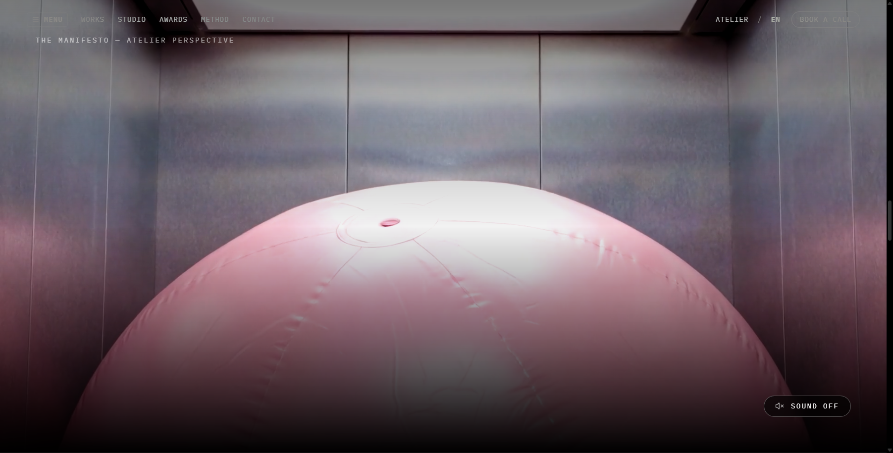
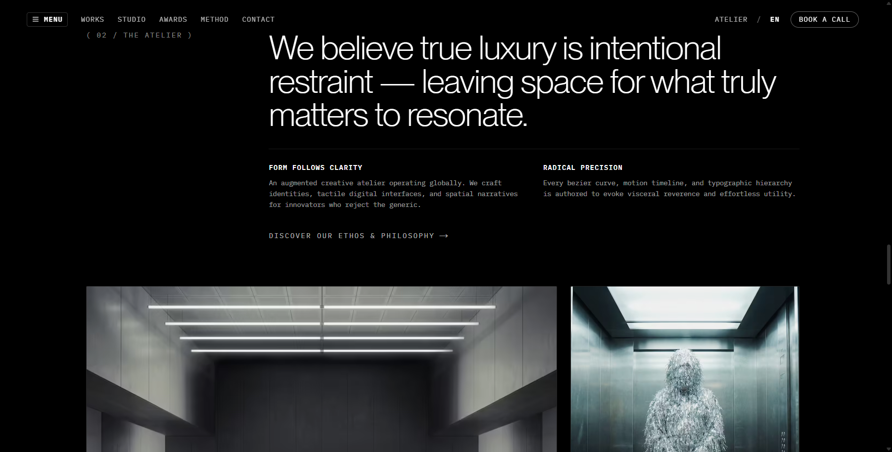
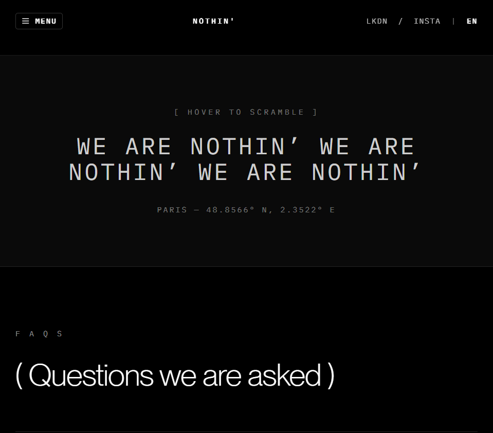
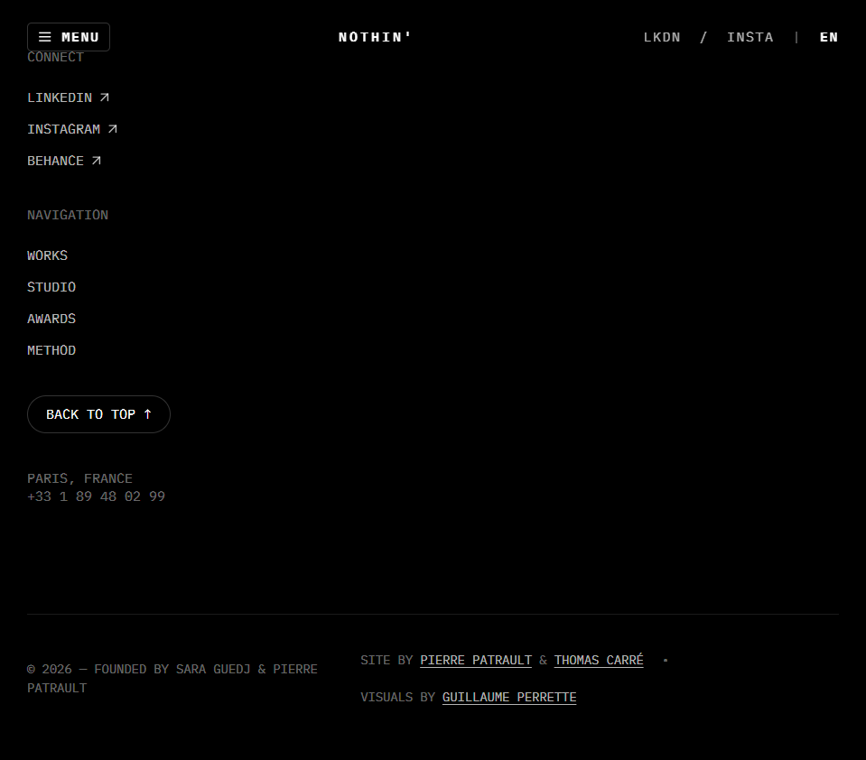

# N'TH ATELIER — Haute Digital Architecture & Sensory Systems

> "Pure form, radical vision. Where the uncharted begins."

A production-grade, bespoke digital flagship for N'TH Atelier — an avant-garde creative direction and digital architecture practice. Engineered with Next.js 14 App Router, TypeScript, Tailwind CSS, Lenis Smooth Scroll, GSAP, and self-hosted WebGL & media pipelines.

**Live Deployment**: [https://n-th.vercel.app](https://n-th.vercel.app)  
**Repository**: [https://github.com/Jay-Raam/N-th](https://github.com/Jay-Raam/N-th)

---

## 📸 Visual Showcase & Interface Gallery

<div align="center">
  
</div>

<br />

| Interface Surface | Visual Architecture |
| :--- | :--- |
| **01. Atelier Hero & Spatial Navigation**<br>Interactive canvas ripple displacement, persistent audio status, dynamic coordinates, and custom magnetic cursor. |  |
| **02. Brand Vector Wordmark & Emblem**<br>Geometric SVG path drawing animated with GSAP ScrollTrigger and reactive illumination. |  |
| **03. Selected Commissions Grid**<br>Asymmetric architectural grid with cursor-following floating vignette previews and category taxonomies. |  |
| **04. Fullscreen Video Manifesto**<br>Self-hosted high-definition video player with custom sound toggle, ambient reflections, and metadata preloading. |  |
| **05. Studio Ethos & Gallery**<br>Spatial typography composition and editorial photography exploring digital architecture and sensory systems. |  |
| **06. Accessible Inquiries & Dossiers**<br>WCAG 2.2 AA compliant WAI-ARIA accordion with smooth transitions and dedicated deep dossier routes (`/faq/[slug]`). |  |
| **07. Atelier Footer & Timezone Engine**<br>Real-time local timezone calculation (`Europe/Zurich`), semantic navigation links, and back-to-top inertial scroll. |  |

---

### 🎥 Self-Hosted Media Assets & Cinematic Video Pipelines

All video and audio pipelines are self-hosted within [`public/videos`](public/videos), eliminating third-party streaming dependencies:

- **Flagship Hero Ambient Loop**: [`public/videos/hero-bg.mp4`](public/videos/hero-bg.mp4) — High-bitrate 1080p background loop with canvas ripple interactions.
- **Cinematic Showreel**: [`public/videos/showreel.mp4`](public/videos/showreel.mp4) — Studio showcase reel with interactive viewport pause observer.
- **Studio Manifesto Video**: [`public/videos/manifesto.mp4`](public/videos/manifesto.mp4) — Atmospheric brand manifesto with ambient reflections and audio state sync.

---

## 🌟 Senior Engineering & Architecture Highlights

This project was refined and architected to the highest standards expected in Senior Frontend Engineer, Creative Developer, and Next.js Architect roles.

### 1. React Lifecycle & Animation Engine Hardening
- **Zero-Re-render Custom Cursor (`src/components/CustomCursor.tsx`)**: Replaced per-frame React state updates with low-overhead mutable `useRef` coordinate pointers and linear interpolation (`lerp`) via `requestAnimationFrame`. Added pointer coarse (`(pointer: coarse)`) touch detection and `prefers-reduced-motion` bypasses to eliminate mobile lag and battery drain.
- **GSAP & Lenis Synchronization (`src/components/SmoothScroll.tsx`)**: Synchronized Lenis scroll events directly with GSAP's internal `Ticker`. Implemented strict lifecycle teardown via `gsap.context()` to guarantee zero memory leaks or detached listeners across Next.js App Router navigations and React Strict Mode double-invocations.
- **Fail-Safe Loader (`src/components/Loader.tsx`)**: Refactored loader intervals and timers into an unmount-tracked timer registry (`timeoutIdsRef`), preventing state updates on unmounted trees and ensuring graceful fast-exit under `prefers-reduced-motion`.

### 2. Next.js 14 Server/Client Component Boundaries
- **Server Component Root (`src/app/page.tsx`)**: Converted the flagship landing page to a React Server Component, streaming static DOM directly to the client while isolating interactive behaviors (Canvas ripple, Lenis, video controls, custom cursor) into tightly scoped client leaves.
- **Static Site Generation (SSG)**: 18 static routes generated at build time (`next build`), enabling instant edge delivery on Vercel without server runtime overhead.
- **Isolated Client Forms & Archives**: Dynamic case studies (`/works/[slug]`) and consultation dispatch (`/contact`) leverage Server Component containers for metadata generation with isolated client interactive modules (`WorksList.tsx`, `ContactForm.tsx`).

### 3. Accessibility (WCAG 2.2 AA Compliance)
- **Accessible Accordions & Drawers**: Fully compliant WAI-ARIA accordion pattern in `src/components/Faq.tsx` (`aria-expanded`, `aria-controls`, `role="region"`). The drawer navigation (`src/components/Navbar.tsx`) supports `Escape` key dismissal and focus trapping semantics.
- **Audio & Video Controls**: Semantic `<button>` triggers with `aria-pressed`, dynamic `aria-label` updates, and explicit keyboard focus indicators (`:focus-visible`).
- **Universal Reduced-Motion Support**: Complete `@media (prefers-reduced-motion: reduce)` support across CSS animations, GSAP tweens, text scrambles, canvas shaders, and smooth scrolling.
- **Accessible Scrollbar**: Restored native visual scrollbars and compliant high-contrast color ratios across light and dark themes.

### 4. Media & Performance Optimization
- **Next.js Image Pipeline**: Enabled native WebP and AVIF modern format conversions with explicit responsive `sizes`, eliminating layout shift (CLS: 0).
- **Metadata Preloading**: Configured video elements with `preload="metadata"` and poster fallbacks to avoid heavy initial byte payload downloads.
- **Self-Hosted Typography**: Fully subsetted, self-hosted WOFF2 fonts for PP Neue Montreal (7 weights) and IBM Plex Mono with zero external render-blocking font networks.

### 5. SEO & Discoverability
- **Dynamic Meta Tags**: Automated `generateMetadata` for dynamic project case studies and FAQ dossiers.
- **Structured Search Engine Protocol**: Validated `robots.txt` and comprehensive XML `sitemap.xml` covering all 18 indexable atelier dossiers.
- **Rich Social Sharing**: OpenGraph and Twitter Card integration with absolute canonical URLs.

---

## 🛠️ Tech Stack

- **Framework**: Next.js 14.2 (App Router, Static Generation)
- **Language**: TypeScript 5 (Strict Mode)
- **Styling**: Tailwind CSS 3.4, PostCSS, Custom CSS Properties
- **Motion & Smooth Scroll**: GSAP 3.12, `@studio-freight/lenis`
- **Typography**: PP Neue Montreal (Pangram Pangram), IBM Plex Mono
- **Icons**: Lucide React
- **CI/CD**: GitHub Actions, Vercel Automated Deployments

---

## 📂 Project Structure

```bash
├── .github/workflows/   # CI/CD automated lint, typecheck & build pipeline
├── public/
│   ├── fonts/           # PP Neue Montreal (7 weights) & IBM Plex Mono WOFF2
│   ├── images/          # 3D floating loader items, project vignettes, studio imagery
│   ├── videos/          # Hero loop, showreel, and manifesto MP4s
│   ├── robots.txt       # Search engine crawler directives
│   └── sitemap.xml      # Full XML index of 18 atelier routes
├── src/
│   ├── app/
│   │   ├── awards/      # Accolades & honors archive (Server Component)
│   │   ├── contact/     # Consultation brief dispatch with client form
│   │   ├── faq/[slug]/  # Dedicated technical dossiers (SSG)
│   │   ├── method/      # 4-stage atelier methodology
│   │   ├── studio/      # Atelier philosophy, pillars, and locations
│   │   ├── works/       # Portfolio archive with client filter
│   │   │   └── [slug]/  # Dynamic case study dossiers (SSG)
│   │   ├── globals.css  # Typography tokens, animations, accessible focus states
│   │   ├── layout.tsx   # Root layout, OpenGraph, viewport, cursor wrapper
│   │   └── page.tsx     # Atelier flagship experience (Server Component)
│   ├── components/      # Modular UI components (Loader, Hero, Works, FAQ, etc.)
│   └── data/            # Static data stores for projects and FAQs
```

---

## 🚀 Getting Started

### Prerequisites
- Node.js 18.17+ or 20+
- npm or pnpm

### Installation

```bash
# Clone the repository
git clone https://github.com/Jay-Raam/N-th.git

# Navigate to project directory
cd N-th

# Install dependencies
npm install

# Run the development server
npm run dev
```

Open [http://localhost:3000](http://localhost:3000) in your browser.

### Verification & Production Build

```bash
# Type check TypeScript
npx tsc --noEmit

# Compile production SSG bundle
npm run build

# Preview production build locally
npm run start
```

---

## 📄 License & Attribution

Crafted for private atelier showcase and creative direction reference. © 2026 N'TH Studio. All rights reserved.
